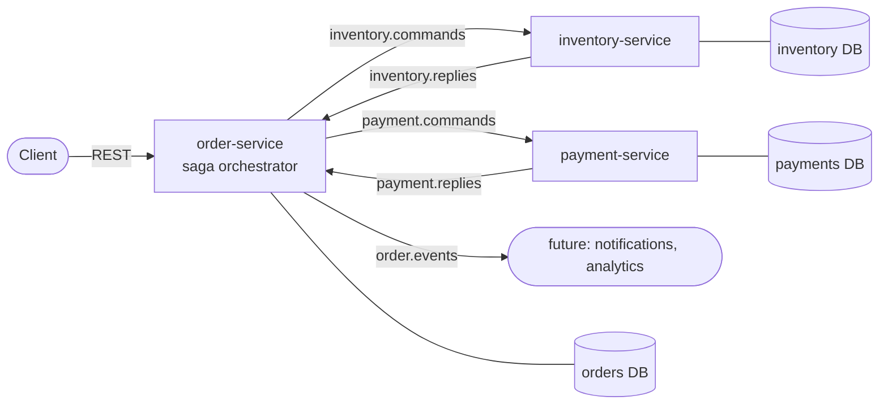
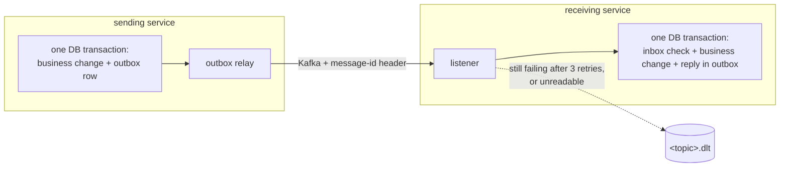
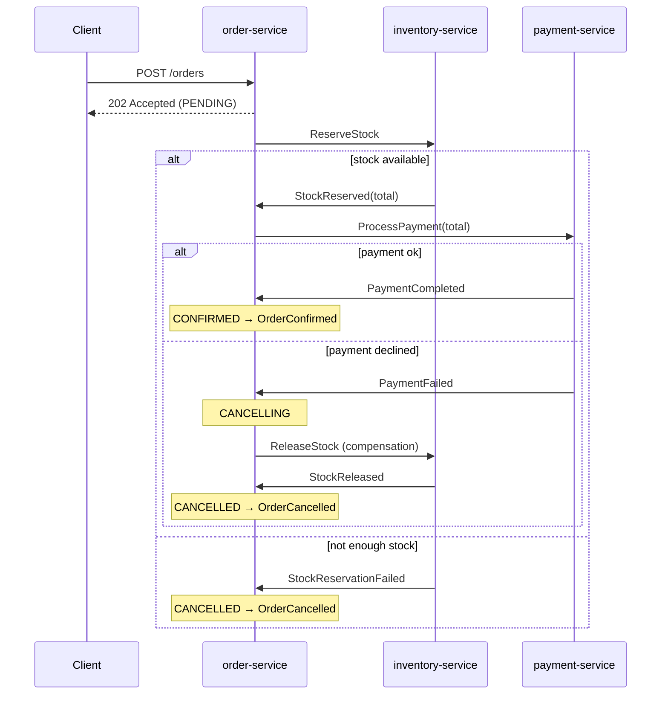

# OrderFlow

[](https://github.com/Zeralius/orderflow/actions/workflows/ci.yml)

An event-driven online-shop backend: Spring Boot microservices that talk over Apache Kafka. One order runs as a **saga** across the services, and every failure path (out of stock, payment declined) is handled and undone where needed.

> Status: **reliable messaging done**. The saga runs across three services with compensation. Messages go through a transactional outbox, are de-duplicated on arrival, and messages that keep failing are parked on dead-letter topics. An end-to-end test runs the real Docker images. Next: Keycloak and an API gateway (see [Roadmap](#roadmap)).

## Architecture



| Module | Port | Role |
|---|---|---|
| `common` | – | Message contracts: topics and the commands, replies and events (Java records, sealed interfaces) |
| `messaging` | – | Reliable messaging as Spring Boot auto-configuration: outbox, inbox, retries, dead letters |
| `order-service` | 8081 | REST API, order state machine, runs the saga |
| `inventory-service` | 8082 | Catalogue, prices and stock; reserves all-or-nothing, releases on request |
| `payment-service` | 8083 | Fake payment provider: declines above a limit, or everything via a demo switch |
| `e2e-tests` | – | Black-box tests: the three services as Docker containers, talking only HTTP |

Each service owns its own database. They share nothing but the messages in `common`.

## Reliable messaging

Every message between the services goes the same way, provided by the `messaging` module:



- **Transactional outbox.** A service never sends to Kafka in the middle of its work. It writes the message into its own `outbox_messages` table, in the same transaction as the change. A relay sends the rows to Kafka in order and marks them sent. Without the outbox, a crash between "saved" and "sent" would leave the saga hanging, or would send a message about a change that was rolled back.
- **Inbox (idempotent consumer).** The relay can send a message twice (a crash after Kafka's ack, before the "sent" mark). Every message carries a unique id. Each receiver records the ids it has processed in `processed_messages`, in the same transaction as the work, and skips repeats.
- **Retries and dead letters.** A failing message is retried 3 times with growing pauses, then parked on `<topic>.dlt`, so it stops blocking the messages behind it. A message that can't even be read goes there straight away. The original topic, partition, offset and error travel along as headers.
- **Several instances.** The relay locks its batch with `FOR UPDATE SKIP LOCKED`, so several instances of a service can share the outbox.

The library plugs in through Spring Boot auto-configuration. A service adds the dependency and the two tables, and calls `outbox.add(...)` and `inbox.firstDelivery(...)`.

## The saga



Order states: `PENDING → STOCK_RESERVED → CONFIRMED`, or `PENDING → CANCELLED`, or `STOCK_RESERVED → CANCELLING → CANCELLED`. Any other move is refused by the domain model.

## Tech stack

Java 25 (records, sealed interfaces, pattern-matching `switch`) · Spring Boot 4.2 · Spring for Apache Kafka · Maven (multi-module, wrapper) · Apache Kafka 4.4 (KRaft) · PostgreSQL 18 · Flyway · Spring Data JPA / Hibernate · Bean Validation · RFC 9457 Problem Details · Testcontainers · JUnit 5 · AssertJ · Spotless · JaCoCo · Docker Compose · GitHub Actions

## Run it locally

Requirements: JDK 25 and Docker.

**Everything in Docker:**

```bash
./mvnw -q package -DskipTests
docker compose --profile apps up -d --build   # services on 8081-8083, PostgreSQL on 5433, Kafka UI on http://localhost:8090
```

**Or the services from your IDE / terminal**, with only the infrastructure in Docker:

```bash
docker compose up -d
java -jar order-service/target/order-service-0.1.0-SNAPSHOT.jar
java -jar inventory-service/target/inventory-service-0.1.0-SNAPSHOT.jar
java -jar payment-service/target/payment-service-0.1.0-SNAPSHOT.jar
```

### Try the three outcomes

```bash
# 1. Confirmed: 2 books at 39.90
curl -i -X POST localhost:8081/orders -H 'Content-Type: application/json' \
  -d '{"customerId":"alice","lines":[{"sku":"BOOK-JAVA25","quantity":2}]}'

# 2. Out of stock: there is only one poster
curl -X POST localhost:8081/orders -H 'Content-Type: application/json' \
  -d '{"customerId":"bob","lines":[{"sku":"LIMITED-POSTER","quantity":2}]}'

# 3. Payment declined (1245.00 is above the 1000.00 limit), stock is given back
curl -X POST localhost:8081/orders -H 'Content-Type: application/json' \
  -d '{"customerId":"carol","lines":[{"sku":"HEADSET-PRO","quantity":5}]}'

# Follow the Location header of each answer:
curl localhost:8081/orders/<id>
```

More to look at:

- `GET localhost:8082/products`: catalogue and stock levels
- `GET localhost:8083/payments/<orderId>`: the payment attempt for an order
- `PUT localhost:8083/admin/payment-mode` with `{"declineAll": true}`: makes every payment fail
- Kafka UI at http://localhost:8090: every command, reply and event on its topic, with its `orderflow-message-id` header; failed messages on the `.dlt` topics
- The tables `outbox_messages` and `processed_messages` in each database (`psql -h localhost -p 5433 -U orderflow orders`)

## Build and test

```bash
./mvnw verify          # format check, compile, all tests incl. end-to-end, coverage (about 2 minutes)
./mvnw spotless:apply  # fix formatting
```

48 tests in total:

- **Message contracts** (`common`): every message survives a JSON round trip with its type name.
- **Order state machine:** unit tests for the allowed and refused moves.
- **Saga** (`order-service`): drives the real REST API, PostgreSQL and Kafka through all three outcomes and through duplicate replies. The test plays inventory and payment.
- **Reliable messaging:**
  - an outbox row is relayed with its message id and marked sent
  - a rolled-back transaction sends nothing
  - the outbox refuses to work outside a transaction
  - a redelivered command is processed once
  - unreadable messages land on the dead-letter topic
- **Inventory:** all-or-nothing reservation, pricing, duplicate SKUs, repeated commands, release exactly once.
- **Payment:** limit, demo switch, no double charge on a repeated command.
- **End to end** (`e2e-tests`): builds Docker images from the three real jars, starts them with PostgreSQL and Kafka, and checks all three outcomes over HTTP only. That includes the stock coming back after a declined payment.

Testcontainers starts real PostgreSQL 18 and Kafka 4.4 containers. Coverage per module ends up in `<module>/target/site/jacoco/index.html`.

## Design decisions

**Orchestration, not choreography.** One place (`OrderSaga`) knows the whole flow and the order's state, so the business process can be read in one file and changed in one place. The cost is coupling: order-service knows about inventory and payment. For a flow with compensation, that trade is worth it.

**Inventory owns the prices.** The client only sends SKUs and quantities. Inventory prices the order while reserving it and reports the total, so a client can't decide what it pays.

**Every step is safe to receive twice, at two levels.** Kafka and the outbox deliver at least once, so duplicates are normal:

- The inbox skips a message id it has already processed.
- The domain logic is idempotent on its own as well:
  - The saga only accepts a reply in the status that expects it (a second `StockReserved` doesn't charge again).
  - Inventory and payment store their decision per order, so a repeated command gets the same answer.
  - A unique order id in the payments table stops two parallel deliveries from both charging.

  This second level covers what the inbox can't see, such as the same command sent twice by mistake under different ids.

**All-or-nothing stock, without deadlocks.** Inventory checks every line before changing anything, and locks product rows in SKU order, so two orders can't deadlock each other.

**Polling outbox, not change data capture.** A relay that polls the outbox table every 200 ms is simple, needs nothing beyond PostgreSQL, and is easy to test. Debezium (reading the database's write-ahead log) would cut the delay and the polling load, at the cost of another moving part to run. For this scale, polling is the better trade.

**One shared library, not copy-paste.** The outbox, inbox and error handling live once in `messaging`, wired in by Spring Boot auto-configuration. Each service still owns its tables (its own Flyway migration), so no service depends on another's database.

**202 Accepted.** Placing an order starts a process; it doesn't finish one. The API answers `202` with a `Location` to poll, instead of pretending the order is done.

## Roadmap

- [x] Setup: Maven multi-module, wrapper, Compose, CI, formatting, coverage
- [x] MVP: message contracts, order API + state machine, inventory, payment, orchestrated saga with compensation, Testcontainers tests
- [x] Reliability: transactional outbox, idempotent consumers (inbox), retries + dead-letter topics, end-to-end tests against the Docker images
- [ ] Security & edge: Keycloak (OAuth2/JWT), Spring Cloud Gateway, notification-service
- [ ] Observability: Micrometer, Prometheus, Grafana, OpenTelemetry tracing
- [ ] Kubernetes (Helm), cloud deployment, Spring AI order-support assistant

## License

[MIT](LICENSE)
