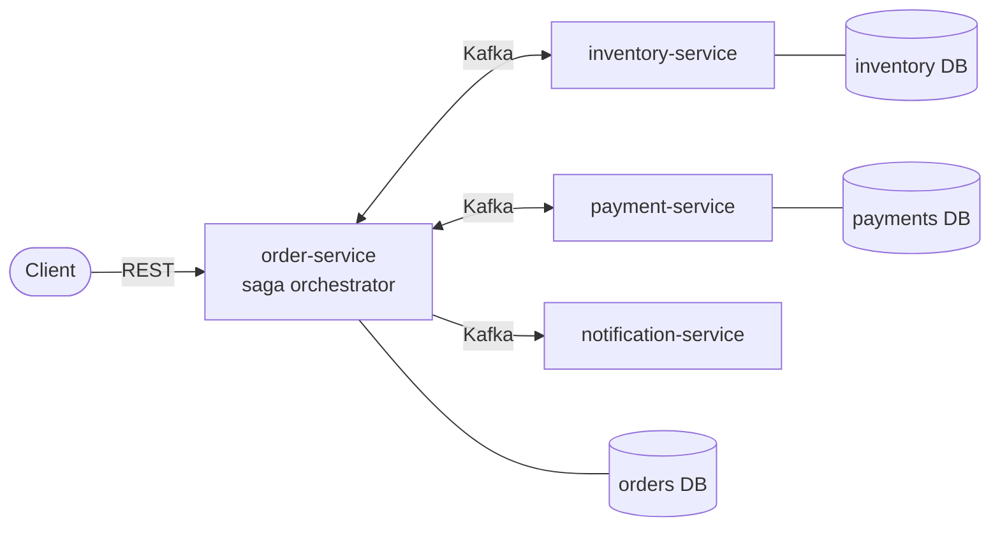

# OrderFlow

An event-driven online-shop backend: Spring Boot microservices that talk over Apache Kafka. One order runs as a **saga** across the services, and every failure path (payment declined, out of stock, a service down) is handled and visible.

> Status: **project setup**. The services start and connect to PostgreSQL and Kafka; the order flow is the next milestone (see [Roadmap](#roadmap)).

## Architecture (planned)



| Module | Port | Role |
|---|---|---|
| `common` | – | Event schemas (Java records) shared by the services |
| `order-service` | 8081 | REST API, order state machine, runs the saga |
| `inventory-service` | 8082 | Reserves and releases stock |
| `payment-service` | 8083 | Fake payment provider that can be told to fail |

Each service owns its own database; they only share events.

## Tech stack

Java 25 · Spring Boot 4.2 · Maven (multi-module, wrapper) · Apache Kafka 4.4 (KRaft) · PostgreSQL 18 · Flyway · Spring Data JPA · Testcontainers · JUnit 5 · Spotless · JaCoCo · Docker Compose · GitHub Actions

## Run it locally

Requirements: JDK 25 and Docker.

```bash
docker compose up -d                          # PostgreSQL, Kafka, Kafka UI (http://localhost:8090)
./mvnw -pl order-service spring-boot:run      # likewise for inventory-service, payment-service
```

Health check: `curl http://localhost:8081/actuator/health`

## Build and test

```bash
./mvnw verify          # format check, compile, tests (Testcontainers starts real PostgreSQL + Kafka), coverage
./mvnw spotless:apply  # fix formatting
```

Coverage report per module: `<module>/target/site/jacoco/index.html`.

## Roadmap

- [x] Setup: Maven multi-module, wrapper, Compose, CI, formatting, coverage
- [ ] MVP: event schemas, order API + state machine, inventory, payment, orchestrated saga with compensation
- [ ] Reliability: transactional outbox, idempotent consumers, retries + dead-letter topics
- [ ] Security & edge: Keycloak (OAuth2/JWT), Spring Cloud Gateway, notification-service
- [ ] Observability: Micrometer, Prometheus, Grafana, OpenTelemetry tracing
- [ ] Kubernetes (Helm), cloud deployment, Spring AI order-support assistant

## Design decisions

Written up as the project grows: orchestration vs choreography, why the outbox, how duplicates are handled.

## License

[MIT](LICENSE)
