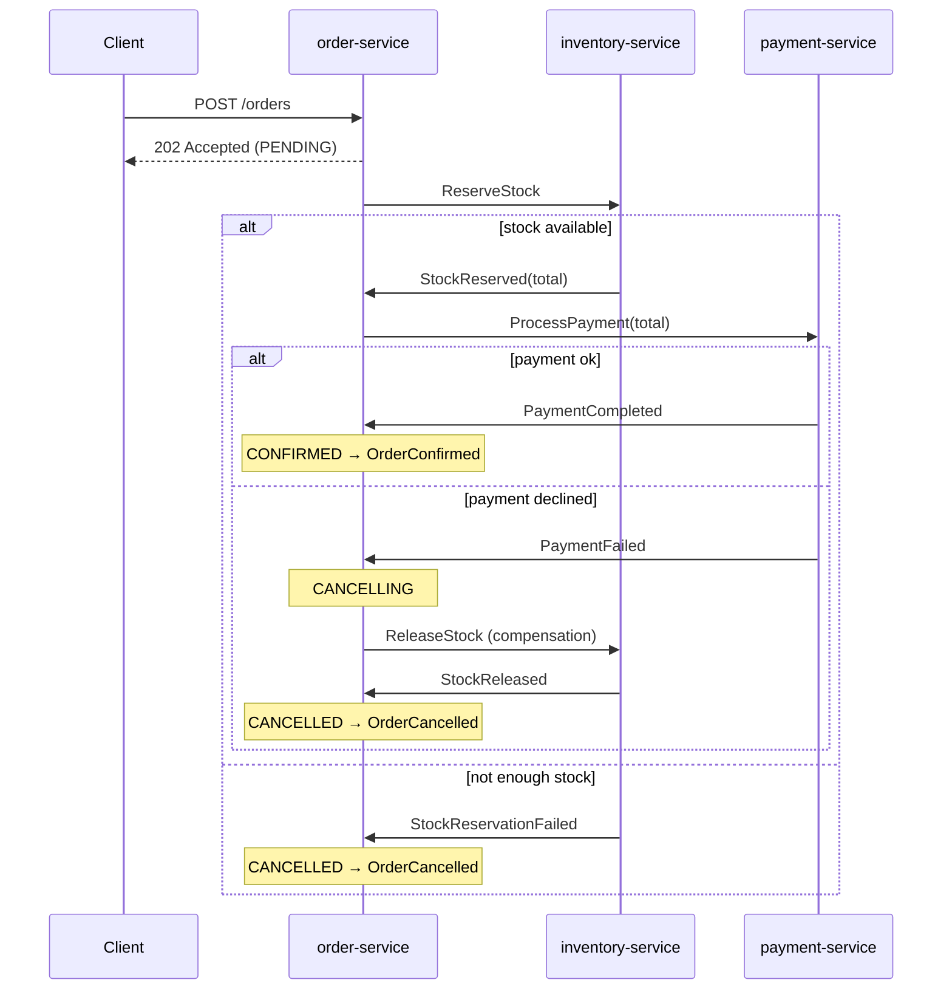

# OrderFlow

[](https://github.com/Zeralius/orderflow/actions/workflows/ci.yml)

An event-driven online-shop backend: Spring Boot microservices that talk over Apache Kafka. One order runs as a **saga** across the services, and every failure path (out of stock, payment declined) is handled and undone where needed.

> Status: **MVP done**: order, inventory and payment services, an orchestrated saga with compensation, and tests against real PostgreSQL and Kafka. Next: transactional outbox, dead-letter topics, Keycloak (see [Roadmap](#roadmap)).

## Architecture


| Module | Port | Role |
|---|---|---|
| `common` | – | Message contracts: topics and the commands, replies and events (Java records, sealed interfaces) |
| `order-service` | 8081 | REST API, order state machine, runs the saga |
| `inventory-service` | 8082 | Catalogue, prices and stock; reserves all-or-nothing, releases on request |
| `payment-service` | 8083 | Fake payment provider: declines above a limit, or everything via a demo switch |

Each service owns its own database. They share nothing but the messages in `common`.

## The saga



Order states: `PENDING → STOCK_RESERVED → CONFIRMED`, or `PENDING → CANCELLED`, or `STOCK_RESERVED → CANCELLING → CANCELLED`. Any other move is refused by the domain model.

## Tech stack

Java 25 (records, sealed interfaces, pattern-matching `switch`) · Spring Boot 4.2 · Spring for Apache Kafka · Maven (multi-module, wrapper) · Apache Kafka 4.4 (KRaft) · PostgreSQL 18 · Flyway · Spring Data JPA / Hibernate · Bean Validation · RFC 9457 Problem Details · Testcontainers · JUnit 5 · AssertJ · Spotless · JaCoCo · Docker Compose · GitHub Actions

## Run it locally

Requirements: JDK 25 and Docker.

```bash
docker compose up -d     # PostgreSQL (localhost:5433), Kafka (9092), Kafka UI (http://localhost:8090)
./mvnw -q install -DskipTests
java -jar order-service/target/order-service-0.1.0-SNAPSHOT.jar
java -jar inventory-service/target/inventory-service-0.1.0-SNAPSHOT.jar
java -jar payment-service/target/payment-service-0.1.0-SNAPSHOT.jar
```

### Try the three outcomes

```bash
# 1. Confirmed: 2 books at 39.90
curl -i -X POST localhost:8081/orders -H 'Content-Type: application/json' \
  -d '{"customerId":"alice","lines":[{"sku":"BOOK-JAVA25","quantity":2}]}'

# 2. Out of stock: there is only one poster
curl -X POST localhost:8081/orders -H 'Content-Type: application/json' \
  -d '{"customerId":"bob","lines":[{"sku":"LIMITED-POSTER","quantity":2}]}'

# 3. Payment declined (1245.00 is above the 1000.00 limit), stock is given back
curl -X POST localhost:8081/orders -H 'Content-Type: application/json' \
  -d '{"customerId":"carol","lines":[{"sku":"HEADSET-PRO","quantity":5}]}'

# Follow the Location header of each answer:
curl localhost:8081/orders/<id>
```

More to look at:

- `GET localhost:8082/products`: catalogue and stock levels
- `GET localhost:8083/payments/<orderId>`: the payment attempt for an order
- `PUT localhost:8083/admin/payment-mode` with `{"declineAll": true}`: makes every payment fail
- Kafka UI at http://localhost:8090: every command, reply and event on its topic

## Build and test

```bash
./mvnw verify          # format check, compile, all tests, coverage
./mvnw spotless:apply  # fix formatting
```

39 tests in total:

- **Message contracts** (`common`): every message survives a JSON round trip with its type name.
- **Order state machine:** unit tests for the allowed and refused moves.
- **Saga** (`order-service`): drives the real REST API, PostgreSQL and Kafka through all three outcomes and through duplicate replies. The test plays inventory and payment.
- **Inventory:** all-or-nothing reservation, pricing, duplicate SKUs, repeated commands, release exactly once.
- **Payment:** limit, demo switch, no double charge on a repeated command.

Testcontainers starts real PostgreSQL 18 and Kafka 4.4 containers. Coverage per module ends up in `<module>/target/site/jacoco/index.html`.

## Design decisions

**Orchestration, not choreography.** One place (`OrderSaga`) knows the whole flow and the order's state, so the business process can be read in one file and changed in one place. The cost is coupling: order-service knows about inventory and payment. For a flow with compensation, that trade is worth it.

**Inventory owns the prices.** The client only sends SKUs and quantities. Inventory prices the order while reserving it and reports the total, so a client can't decide what it pays.

**Every step is safe to receive twice.** Kafka delivers at least once, so duplicates are normal:

- The saga only accepts a reply in the status that expects it (a second `StockReserved` doesn't charge again).
- Inventory and payment store their decision per order, so a repeated command gets the same answer. A unique order id in the payments table stops two parallel deliveries from both charging.

**All-or-nothing stock, without deadlocks.** Inventory checks every line before changing anything, and locks product rows in SKU order, so two orders can't deadlock each other.

**Messages leave after the commit.** Messages are sent only after the database transaction commits, so no message refers to data that was rolled back. The remaining gap, a crash between commit and send, is what the **transactional outbox** (next milestone) closes.

**202 Accepted.** Placing an order starts a process; it doesn't finish one. The API answers `202` with a `Location` to poll, instead of pretending the order is done.

## Roadmap

- [x] Setup: Maven multi-module, wrapper, Compose, CI, formatting, coverage
- [x] MVP: message contracts, order API + state machine, inventory, payment, orchestrated saga with compensation, Testcontainers tests
- [ ] Reliability: transactional outbox, idempotent consumers (processed-message table), retries + dead-letter topics, end-to-end test module
- [ ] Security & edge: Keycloak (OAuth2/JWT), Spring Cloud Gateway, notification-service
- [ ] Observability: Micrometer, Prometheus, Grafana, OpenTelemetry tracing
- [ ] Kubernetes (Helm), cloud deployment, Spring AI order-support assistant

## License

[MIT](LICENSE)
