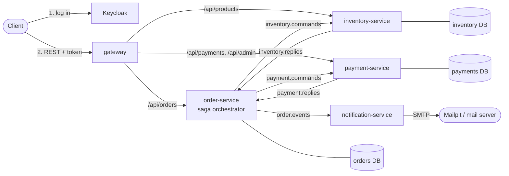
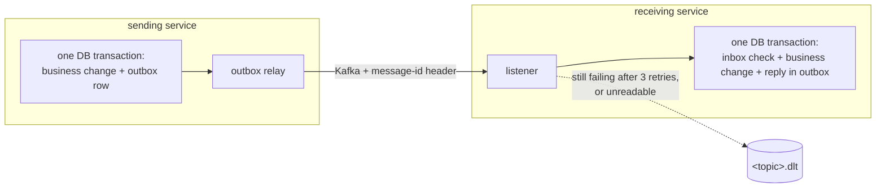
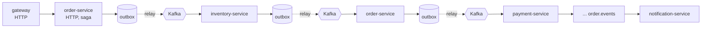
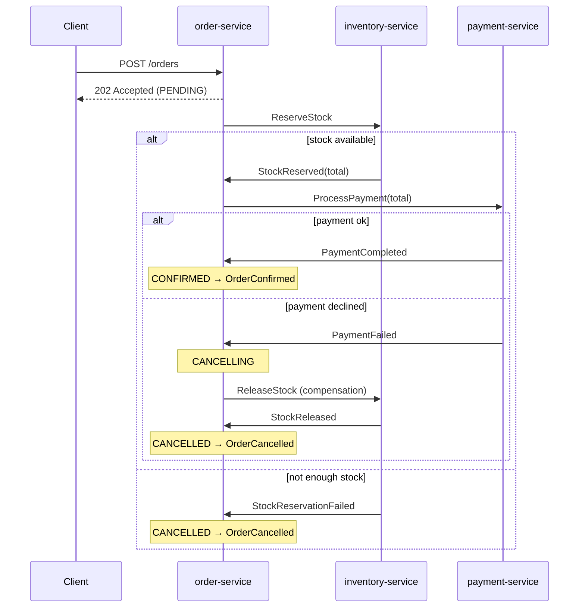
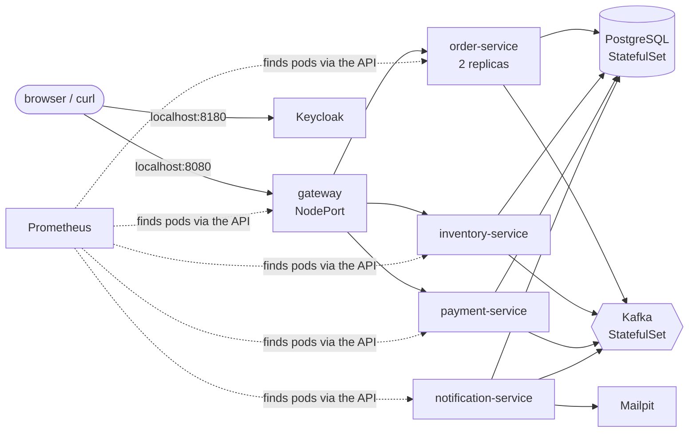

# OrderFlow

[](https://github.com/Zeralius/orderflow/actions/workflows/ci.yml)

An event-driven online-shop backend: Spring Boot microservices that talk over Apache Kafka. One order runs as a **saga** across the services, and every failure path (out of stock, payment declined) is handled and undone where needed.

> Status: **feature-complete core**. The saga runs across the services with compensation, over reliable messaging (transactional outbox, inbox, dead-letter topics). Customers get an email when their order is confirmed or cancelled. Everything sits behind a rate-limited API gateway with one Swagger UI for all APIs, and users log in through Keycloak. ArchUnit rules enforce the architecture in every build. Every service reports metrics to Prometheus (with a Grafana dashboard), and one order is one trace across all services, even through Kafka and the outbox. An end-to-end test runs the real Docker images with real logins, real email and real traces. The whole system also runs on Kubernetes from one Helm chart, and CI installs it on a kind cluster and places an order through it on every push. Next: a cloud deployment (see [Roadmap](#roadmap)).

## Architecture



| Module | Port | Role |
|---|---|---|
| `common` | – | Message contracts: topics and the commands, replies and events (Java records, sealed interfaces) |
| `messaging` | – | Reliable messaging as Spring Boot auto-configuration: outbox, inbox, retries, dead letters |
| `security` | – | Shared OAuth2 setup: Keycloak roles to Spring Security, common API defaults, the OpenAPI frame |
| `observability` | – | One dependency for metrics (Prometheus) and tracing (OpenTelemetry, OTLP), plus shared settings |
| `architecture-rules` | – | ArchUnit rules every service checks in its build |
| `gateway` | 8080 | The single entry point: checks the token, limits the request rate, routes `/api/**` to the services, serves Swagger UI |
| `order-service` | 8081 | REST API, order state machine, runs the saga |
| `inventory-service` | 8082 | Catalogue, prices and stock; reserves all-or-nothing, releases on request |
| `payment-service` | 8083 | Fake payment provider: declines above a limit, or everything via a demo switch |
| `notification-service` | 8084 | Emails the customer when an order is confirmed or cancelled (no public API) |
| `e2e-tests` | – | Black-box tests: the whole system as Docker containers, with real Keycloak logins, talking only HTTP to the gateway |

Each service owns its own database. They share nothing but the messages in `common`.

## Reliable messaging

Every message between the services goes the same way, provided by the `messaging` module:



- **Transactional outbox.** A service never sends to Kafka in the middle of its work. It writes the message into its own `outbox_messages` table, in the same transaction as the change. A relay sends the rows to Kafka in order and marks them sent. Without the outbox, a crash between "saved" and "sent" would leave the saga hanging, or would send a message about a change that was rolled back.
- **Inbox (idempotent consumer).** The relay can send a message twice (a crash after Kafka's ack, before the "sent" mark). Every message carries a unique id. Each receiver records the ids it has processed in `processed_messages`, in the same transaction as the work, and skips repeats.
- **Retries and dead letters.** A failing message is retried 3 times with growing pauses, then parked on `<topic>.dlt`, so it stops blocking the messages behind it. A message that can't even be read goes there straight away. The original topic, partition, offset and error travel along as headers.
- **Several instances.** The relay locks its batch with `FOR UPDATE SKIP LOCKED`, so several instances of a service can share the outbox.

The library plugs in through Spring Boot auto-configuration. A service adds the dependency and the two tables, and calls `outbox.add(...)` and `inbox.firstDelivery(...)`.

## Security

Users log in at **Keycloak** (OpenID Connect) and send the access token with every request. The realm, with its roles, a demo client and demo users, is part of the repository (`docker/keycloak/orderflow-realm.json`) and is imported when Keycloak starts.

| User / password | Roles |
|---|---|
| `alice` / `alice`, `bob` / `bob`, `carol` / `carol` | customer |
| `admin` / `admin` | admin, customer |

Every token is checked **twice**: by the gateway, and again by the service it reaches. That includes signature, expiry, issuer, and audience (`orderflow-api`). A service never trusts that a request came through the gateway.

| Endpoint (through the gateway) | Who |
|---|---|
| `GET /api/products/**` | anyone, no token |
| `POST /api/orders`, `GET /api/orders` | customer, admin. The customer is taken from the token, never from the request body |
| `GET /api/orders/{id}` | the order's own customer, or an admin. Anyone else gets 404, so order ids can't be probed |
| `GET /api/payments/{orderId}`, `/api/admin/**` | admin |
| no or invalid token | 401, stopped at the gateway |
| more than 120 requests a minute | 429 Too Many Requests: per user (anonymous callers per IP), across all routes |

## Notifications

`notification-service` listens to `order.events` and emails the customer: "confirmed" with the total, or "cancelled" with the reason. The address comes from the customer's login token: order-service stores it with the order and puts it in the event, so the notification service needs no customer database. Locally every email lands in **Mailpit** (http://localhost:8025).

The service uses the same reliable messaging as the others: an inbox against duplicates, retries, then the dead-letter topic. Every decision is logged in a `notifications` table (`SENT`, or `SKIPPED` when an account has no address).

## Observability

**Metrics.** Every service serves `/actuator/prometheus`. Prometheus scrapes them, and Grafana shows the **OrderFlow overview** dashboard (http://localhost:3000, it opens directly):

| Metric | What it tells you |
|---|---|
| `orderflow_orders_placed_total` | Orders accepted by the API |
| `orderflow_orders_completed_seconds` (by `outcome`) | How orders end (confirmed / cancelled) and how long the whole saga took (p50/p95) |
| `orderflow_outbox_pending` (per service) | Messages written but not yet sent; should stay near 0, growing means Kafka is unreachable |
| `orderflow_outbox_sent_total` (by `topic`) | Messages delivered to Kafka |
| `orderflow_inbox_duplicates_total` | Redeliveries the inbox recognised and skipped |
| `orderflow_messages_dead_lettered_total` | Messages parked on a `.dlt` topic; any of these deserves a look |
| `orderflow_notifications_total` (by `kind`, `status`) | Emails sent or skipped |
| `http_server_requests_seconds` | Requests, latency percentiles and status codes per service (401/429/503 at the gateway) |

**Traces.** Every service sends its spans to Jaeger (http://localhost:16686) over OTLP. One order is **one trace** from the gateway to the last email, 34 spans across five services in a typical run, about 1.2 s end to end, even though it crosses Kafka several times:



This needs one piece of plumbing. A message is written in the request's thread but sent later by the outbox relay, on another thread, where the trace would normally be lost. So the outbox stores the trace context (`traceparent`) with each row, and the relay continues that trace when it sends the row. The relay's 200 ms polling is kept out of tracing on purpose, or Jaeger would fill up with empty polls. Trace and span ids also appear in every log line.

To trace services started from the IDE, set `MANAGEMENT_OPENTELEMETRY_TRACING_EXPORT_OTLP_ENDPOINT=http://localhost:4318/v1/traces`. Without that variable nothing is exported.

## Architecture rules

`architecture-rules` holds [ArchUnit](https://www.archunit.org/) rules that every service checks against its own code in every build, so these promises can't quietly erode:

- **Messages leave only through the outbox.** Nothing outside the messaging library touches `KafkaTemplate` or a Kafka producer.
- **Kafka listeners are `@Transactional`.** The inbox only works if its entry commits together with the work.
- **REST endpoints return DTOs, never JPA entities.**
- **The domain model knows nothing about HTTP, Kafka, the saga or the API layer.**
- **Nothing calls into controllers.**
- **No field injection.**
- **No cycles between packages.**

A rule that never fails proves nothing, so the module's own tests feed each key rule a deliberately broken class and expect it to fail.

## The saga



Order states: `PENDING → STOCK_RESERVED → CONFIRMED`, or `PENDING → CANCELLED`, or `STOCK_RESERVED → CANCELLING → CANCELLED`. Any other move is refused by the domain model.

## Tech stack

Java 25 (records, sealed interfaces, pattern-matching `switch`) · Spring Boot 4.2 · Micrometer + Prometheus + Grafana · OpenTelemetry (OTLP) + Jaeger · Spring Security 7 (OAuth2 resource server) · Keycloak 26 · Spring Cloud Gateway (Server WebMVC) · Bucket4j · springdoc-openapi / Swagger UI · Spring Mail + Mailpit · ArchUnit · Spring for Apache Kafka · Maven (multi-module, wrapper) · Apache Kafka 4.4 (KRaft) · PostgreSQL 18 · Flyway · Spring Data JPA / Hibernate · Bean Validation · RFC 9457 Problem Details · Testcontainers · JUnit 5 · AssertJ · Spotless · JaCoCo · Docker Compose · Kubernetes + Helm (kind locally) · GitHub Actions

## Run it locally

Requirements: JDK 25 and Docker.

**Everything in Docker:**

```bash
./mvnw -q package -DskipTests
docker compose --profile apps up -d --build
```

| What | Where |
|---|---|
| Gateway (the API) | http://localhost:8080 |
| **Swagger UI**, all APIs (click *Authorize* and log in, e.g. `alice` / `alice`) | http://localhost:8080/swagger-ui.html |
| Mailpit, every email sent | http://localhost:8025 |
| **Grafana**, the OrderFlow dashboard | http://localhost:3000 |
| **Jaeger**, traces (search for service `gateway`) | http://localhost:16686 |
| Prometheus | http://localhost:9090 |
| Keycloak (admin console login `admin` / `admin`) | http://localhost:8180 |
| Kafka UI | http://localhost:8090 |
| The services themselves | 8081-8084 |
| PostgreSQL | localhost:5433 |

Upgrading from an older checkout whose PostgreSQL volume already exists? Create the database the notification service needs: `docker compose exec postgres createdb -U orderflow notifications`. Or start fresh with `docker compose down -v`.

**Or the services from your IDE / terminal**, with only the infrastructure in Docker:

```bash
docker compose up -d
java -jar order-service/target/order-service-0.1.0-SNAPSHOT.jar
java -jar inventory-service/target/inventory-service-0.1.0-SNAPSHOT.jar
java -jar payment-service/target/payment-service-0.1.0-SNAPSHOT.jar
java -jar notification-service/target/notification-service-0.1.0-SNAPSHOT.jar
java -jar gateway/target/gateway-0.1.0-SNAPSHOT.jar
```

**Or on Kubernetes**, with [kind](https://kind.sigs.k8s.io/) and [Helm](https://helm.sh/) installed (stop Compose first, the ports are the same):

```bash
deploy/kind.sh            # builds, starts a kind cluster, installs the chart, runs helm test (first run ~5 min)
kubectl -n orderflow get pods
deploy/kind.sh --delete   # removes the cluster
```

Everything in the table above is then at the same address, so the commands below work unchanged. See [Kubernetes](#kubernetes).

### Try the three outcomes

First log in. The demo client allows the password grant, so a token is one `curl` away:

```bash
token() {
  curl -s localhost:8180/realms/orderflow/protocol/openid-connect/token \
    -d grant_type=password -d client_id=orderflow-demo -d username=$1 -d password=$1 \
    | sed -E 's/.*"access_token":"([^"]+)".*/\1/'
}
```

Then order through the gateway:

```bash
# 1. Confirmed: 2 books at 39.90
curl -i -X POST localhost:8080/api/orders -H "Authorization: Bearer $(token alice)" \
  -H 'Content-Type: application/json' -d '{"lines":[{"sku":"BOOK-JAVA25","quantity":2}]}'

# 2. Out of stock: there is only one poster
curl -X POST localhost:8080/api/orders -H "Authorization: Bearer $(token bob)" \
  -H 'Content-Type: application/json' -d '{"lines":[{"sku":"LIMITED-POSTER","quantity":2}]}'

# 3. Payment declined (1245.00 is above the 1000.00 limit), stock is given back
curl -X POST localhost:8080/api/orders -H "Authorization: Bearer $(token carol)" \
  -H 'Content-Type: application/json' -d '{"lines":[{"sku":"HEADSET-PRO","quantity":5}]}'

# Follow the Location header of an answer (it points at the gateway), as the same user:
curl localhost:8080/api/orders/<id> -H "Authorization: Bearer $(token alice)"
```

More to look at:

- `GET localhost:8080/api/products`: catalogue and stock levels (no token needed)
- `GET localhost:8080/api/orders`: your own orders
- `GET localhost:8080/api/payments/<orderId>` as `admin`: the payment attempt for an order
- `PUT localhost:8080/api/admin/payment-mode` as `admin`, with `{"declineAll": true}`: makes every payment fail (403 for customers)
- http://localhost:8025: the confirmation and cancellation emails alice, bob and carol just got
- http://localhost:3000: the dashboard counting those three orders, how they ended and how long they took
- http://localhost:16686: each order as one trace through all services
- Kafka UI at http://localhost:8090: every command, reply and event on its topic, with its `orderflow-message-id` header; failed messages on the `.dlt` topics
- The tables `outbox_messages` and `processed_messages` in each database (`psql -h localhost -p 5433 -U orderflow orders`)

## Kubernetes

The Helm chart in [`deploy/helm/orderflow`](deploy/helm/orderflow) installs the whole system: the four services and the gateway, plus (switchable) the infrastructure they need. [`deploy/kind.sh`](deploy/kind.sh) runs it on a local [kind](https://kind.sigs.k8s.io/) cluster, and CI does the same on every push.



What the chart does:

- **Probes from Spring Boot.** Startup, liveness and readiness use `/actuator/health/liveness` and `/readiness`. A pod gets traffic only when it is ready, and a rolling update starts a new pod before it stops an old one (`maxUnavailable: 0`).
- **Clean shutdowns.** A `preStop` pause lets Kubernetes take the pod out of the Service before Spring Boot shuts down gracefully, so no request lands on a pod that is going away.
- **Two order-service replicas**, safe because of how the messaging works: the outbox relays lock rows with `SKIP LOCKED`, so no message is sent twice, and Kafka splits the reply topics between the two consumers. A PodDisruptionBudget keeps one running during node drains.
- **Locked down.** Images run as a fixed non-root user, with a read-only root filesystem, no Linux capabilities and the default seccomp profile. NetworkPolicies let only the gateway (and Prometheus) reach the services, and only the apps that use them reach PostgreSQL and Kafka.
- **Configuration from the cluster.** Shared settings live in a ConfigMap (the pods restart when it changes), the database login in a Secret. The services keep the same environment variables as in Docker Compose.
- **Prometheus finds the pods itself** through the Kubernetes API (read-only, this namespace only), so every replica is scraped, and a new service only needs the `prometheus.io/scrape` annotation. The Grafana dashboard is the same file as in Compose.
- **Dependencies first.** A tiny init container waits until PostgreSQL and Kafka answer, so the apps don't crash-loop while the cluster comes up.
- **`helm test`** logs in as alice, places an order through the gateway and waits until the saga confirms it, all from inside the cluster.

**Demo infrastructure, switchable.** PostgreSQL, Kafka, Keycloak, Mailpit, Jaeger, Prometheus, Grafana and Kafka UI run in the cluster as single instances. That is fine for a laptop or a demo, not for production. In a real environment you'd set `devInfrastructure.enabled=false` and point `database`, `kafka` and `oidc` at managed services; the apps don't change.

Run it by hand instead of with the script:

```bash
kind create cluster --config deploy/kind/cluster.yaml
./mvnw -q package -DskipTests
for app in gateway order-service inventory-service payment-service notification-service; do
  docker build -t orderflow/$app:dev $app && kind load docker-image orderflow/$app:dev --name orderflow
done
helm install orderflow deploy/helm/orderflow -n orderflow --create-namespace --wait
helm test orderflow -n orderflow --logs
```

## Build and test

```bash
./mvnw verify          # format check, compile, all tests incl. architecture and end-to-end, coverage (about 5-6 minutes)
./mvnw spotless:apply  # fix formatting
```

121 tests in total:

- **Message contracts** (`common`): every message survives a JSON round trip with its type name.
- **Order state machine:** unit tests for the allowed and refused moves.
- **Saga** (`order-service`): drives the real REST API, PostgreSQL and Kafka through all three outcomes and through duplicate replies. The test plays inventory and payment.
- **Reliable messaging:**
  - an outbox row is relayed with its message id and marked sent
  - a rolled-back transaction sends nothing
  - the outbox refuses to work outside a transaction
  - a redelivered command is processed once
  - unreadable messages land on the dead-letter topic
- **Inventory:** all-or-nothing reservation, pricing, duplicate SKUs, repeated commands, release exactly once.
- **Payment:** limit, demo switch, no double charge on a repeated command.
- **Security:**
  - Keycloak roles become Spring roles
  - no token → 401, a token without the role → 403
  - the customer comes from the token, not the body
  - customers can't see each other's orders, admins see all
  - the order list shows only your own orders
  - only admins can use the payment switch
- **Notifications** (against a real Mailpit): confirmation and cancellation emails, one email for a redelivered event, nothing sent without an address.
- **Observability:** the trace survives the outbox (the Kafka record carries the request's trace id); Prometheus can scrape the business metrics without a token.
- **Architecture:** 7 ArchUnit rules in every service, plus proof that the key rules catch broken code.
- **Gateway:**
  - routing with `/api` stripped
  - rate limiting: 429 after the limit, per user and across routes
  - docs routes and Swagger UI
  - no token stops at the gateway
  - unknown paths are denied
  - Location headers get their `/api` back
  - a service that is down gives a 503 Problem Detail
- **End to end** (`e2e-tests`): builds Docker images from the real jars and starts the whole system, including Keycloak and the gateway. It logs in like a user and checks everything over HTTP through the gateway:
  - all three order outcomes, including the stock coming back after a declined payment
  - 401 without a token, 404 for someone else's order, 403 on the payment switch for customers
  - a Location header that works
  - the confirmation and cancellation emails in Mailpit
  - Swagger UI and every service's API description through the gateway
  - one order shows up in Jaeger as one trace spanning all five services

**Kubernetes** (CI job `kubernetes`): lints the chart, checks that its copies of the realm, dashboard and database script match the Compose files, installs everything on a kind cluster and runs `helm test`.

Testcontainers starts real PostgreSQL 18 and Kafka 4.4 containers. Coverage per module ends up in `<module>/target/site/jacoco/index.html`.

## Design decisions

**Orchestration, not choreography.** One place (`OrderSaga`) knows the whole flow and the order's state, so the business process can be read in one file and changed in one place. The cost is coupling: order-service knows about inventory and payment. For a flow with compensation, that trade is worth it.

**Inventory owns the prices.** The client only sends SKUs and quantities. Inventory prices the order while reserving it and reports the total, so a client can't decide what it pays.

**Every step is safe to receive twice, at two levels.** Kafka and the outbox deliver at least once, so duplicates are normal:

- The inbox skips a message id it has already processed.
- The domain logic is idempotent on its own as well:
  - The saga only accepts a reply in the status that expects it (a second `StockReserved` doesn't charge again).
  - Inventory and payment store their decision per order, so a repeated command gets the same answer.
  - A unique order id in the payments table stops two parallel deliveries from both charging.

  This second level covers what the inbox can't see, such as the same command sent twice by mistake under different ids.

**All-or-nothing stock, without deadlocks.** Inventory checks every line before changing anything, and locks product rows in SKU order, so two orders can't deadlock each other.

**Polling outbox, not change data capture.** A relay that polls the outbox table every 200 ms is simple, needs nothing beyond PostgreSQL, and is easy to test. Debezium (reading the database's write-ahead log) would cut the delay and the polling load, at the cost of another moving part to run. For this scale, polling is the better trade.

**One shared library, not copy-paste.** The outbox, inbox and error handling live once in `messaging`, wired in by Spring Boot auto-configuration. Each service still owns its tables (its own Flyway migration), so no service depends on another's database.

**202 Accepted.** Placing an order starts a process; it doesn't finish one. The API answers `202` with a `Location` to poll, instead of pretending the order is done.

**Defence in depth: the gateway and the services both check the token.** The gateway turns away anything without a valid token before it costs a service anything. Each service still checks again and applies its own rules (roles, ownership), so a request that gets around the gateway, say from inside the network, gets nothing. Coarse checks happen at the edge; the decisions stay with the service that owns the data.

**Identity from the token, not the request.** `POST /orders` has no customer field: the customer is the logged-in user. Someone else's order answers 404 instead of 403, so a stranger can't even tell that an order id exists.

**The audience is checked too.** Tokens must be issued for `orderflow-api` (a Keycloak audience mapper adds it). A token from the same Keycloak that was meant for another application doesn't work here.

**The event carries what its consumers need.** The customer's email address travels in `OrderConfirmed` and `OrderCancelled`, taken from the login token when the order was placed. The alternative, notification-service looking addresses up in Keycloak, would couple it to the identity provider and fail whenever Keycloak is down. The cost is a little personal data in the event stream.

**Email is at least once.** Sending mail can't be part of a database transaction. If the mail went out but the commit then failed, the retry sends it again. For order emails, a rare duplicate is better than a lost one.

**Rate limits live in the gateway, in memory.** Bucket4j token buckets per user, in a Caffeine cache. That is right for one gateway instance; several instances would each count separately, and the buckets would move to Redis (Bucket4j has a Redis backend with the same interface).

**One Swagger UI, logged in through Keycloak.** Each service describes its own API (springdoc). The gateway collects the descriptions under `/docs/*` and serves one Swagger UI. The "Authorize" button runs a real Keycloak login (authorization code with PKCE), so "Try it out" calls the secured endpoints through the gateway.

**Architecture rules, chosen on purpose.** Each ArchUnit rule protects a promise the code actually relies on, such as the outbox or the transactional listeners. A popular rule is deliberately missing: "controllers never touch repositories". Here, simple reads (`GET /orders/{id}`) go straight to the repository, and every change goes through the saga or a service. Forcing a pass-through service in between would add code without adding safety.

**The trace travels with the outbox row.** Tracing usually follows a request through threads and HTTP calls automatically. The outbox breaks that chain: the row is written now and sent later by a scheduled relay. Storing the W3C `traceparent` in the row and continuing it in the relay keeps a whole order in one trace, so you can follow it from the gateway to the email in one view.

**Prometheus pulls; traces are pushed.** Metrics are scraped from `/actuator/prometheus` (no collector needed, easy to inspect by hand), while spans go out over OTLP, the vendor-neutral protocol: switching from Jaeger to Tempo, Honeycomb or Datadog is a configuration change. Every trace is kept (sampling 100%) because this is a demo; in production it would be a small fraction.

**A hand-written chart, not Bitnami subcharts.** The chart is small enough to read in one sitting, and every setting in it is there for a reason this README explains. The infrastructure part is deliberately simple (one PostgreSQL, one Kafka broker) because in production it would be managed services anyway, so it sits behind one switch.

**NodePorts locally, an ingress in the cloud.** kind maps the NodePorts to the same localhost ports as Docker Compose, so Keycloak's issuer (`http://localhost:8180`) is the same for the browser, curl and the services. A public deployment needs a real hostname and TLS in front of the gateway and Keycloak; that comes with the cloud step.

**Error pages pass security, and a down service is a 503.** Spring Security also guards the error page. With a "deny everything else" rule, a service that was down reached the client as a misleading 403. The shared security defaults now let error dispatches through, and the gateway answers an unreachable service with an explicit 503 Problem Detail.

## Roadmap

- [x] Setup: Maven multi-module, wrapper, Compose, CI, formatting, coverage
- [x] MVP: message contracts, order API + state machine, inventory, payment, orchestrated saga with compensation, Testcontainers tests
- [x] Reliability: transactional outbox, idempotent consumers (inbox), retries + dead-letter topics, end-to-end tests against the Docker images
- [x] Security & edge: Keycloak (OAuth2/JWT, roles, audience), Spring Cloud Gateway, ownership checks, end-to-end with real logins
- [x] Edge polish: notification-service with Mailpit, rate limiting at the gateway, OpenAPI + one Swagger UI with Keycloak login, ArchUnit rules
- [x] Observability: business metrics with Micrometer + Prometheus, a provisioned Grafana dashboard, OpenTelemetry tracing into Jaeger, traces carried across the outbox
- [x] Kubernetes: one Helm chart for the whole system, kind locally and in CI, probes, graceful rollouts, NetworkPolicies, non-root read-only pods, `helm test`
- [ ] Cloud deployment, Spring AI order-support assistant

## License

[MIT](LICENSE)
